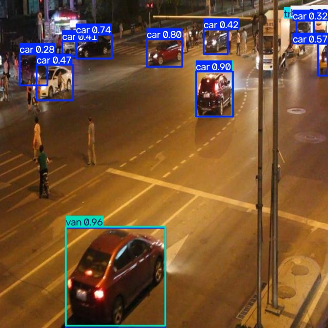
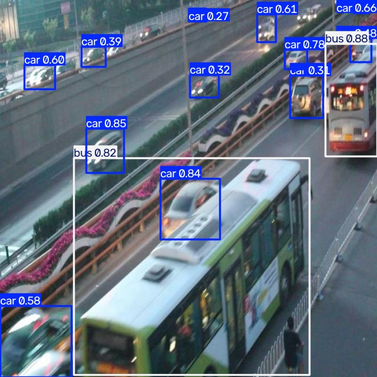
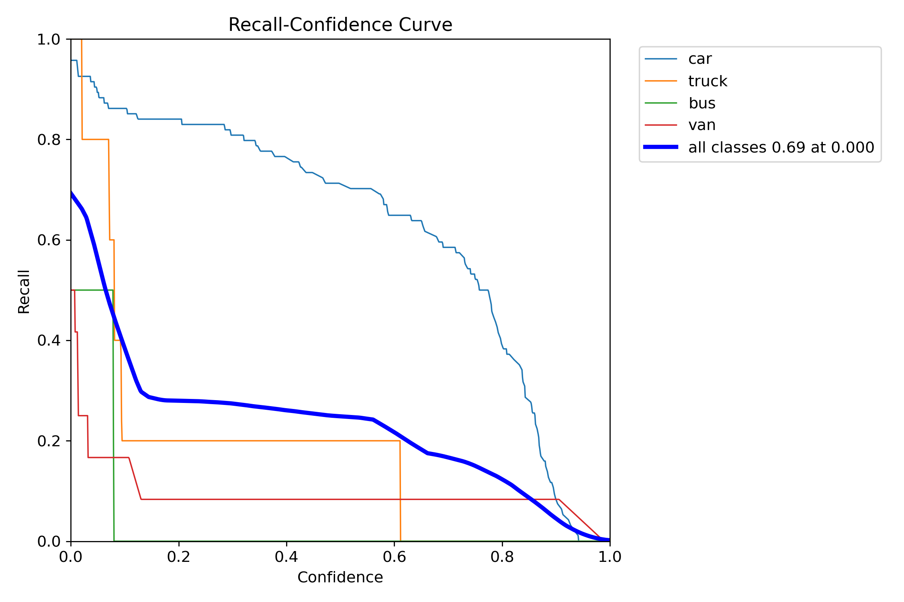

# Báo cáo cá nhân — Ngày 2 Object Detection


## 1. Thông tin học viên

- Họ tên: **DaoBinhAn**.
- MSSV: **2A202603264**.
- Email: **daoan2004@gmail.com**.
- Lớp: K5, Level 2.
- Link repo bài làm: [K5-L2-DAY02-DaoBinhAn-2A202603264-ObjectDetection](https://github.com/daoan2004/K5-L2-DAY02-DaoBinhAn-2A202603264-ObjectDetection).
- Link Colab đã chạy: [Notebook Colab có kết quả](https://colab.research.google.com/drive/1RQ9lrQNClR40d3zjb0h5v76xHzjbDrWE?usp=sharing).

## 2. Schema và mini guideline

Áp dụng schema cố định trong [data.yaml](../../data.yaml): `0=car`, `1=truck`, `2=bus`, `3=van`. Quy tắc chi tiết và điểm phân biệt giữa các lớp được trình bày trong [GUIDELINE_MINI.md](../../GUIDELINE_MINI.md).

Mỗi xe hợp lệ có một box riêng, ôm sát phần nhìn thấy. Xe bị che hoặc cắt khung vẫn được gán nếu nhận diện được lớp; không suy đoán phần bị che hoặc nằm ngoài ảnh. Xe đang đỗ vẫn được gán theo loại xe. Không gán người, xe máy, xe đạp và các vật thể ngoài bốn lớp.

Ba tình huống được đối chiếu với ảnh và nhãn train hiện có:

| Ảnh | Tình huống | Quyết định theo guideline |
|---|---|---|
| [drive_001.jpg](../../dataset/images/train/drive_001.jpg) | Xe con màu trắng ở nửa phải ảnh bị cột tiền cảnh che một phần. | Gán `car`; box bao quanh phần xe còn nhìn thấy, không ước lượng thêm phần bị che. |
| [drive_002.jpg](../../dataset/images/train/drive_002.jpg) | Xe van màu sáng sát mép phải bị cắt khung. | Gán `van`; box giới hạn trong ảnh và cạnh phải chạm rìa ảnh. |
| [drive_003.jpg](../../dataset/images/train/drive_003.jpg) | Nhiều xe con và taxi xếp sát nhau, có che khuất. | Tách box cho từng xe còn nhận diện được; taxi dùng cùng lớp `car`. |

Phần cần giảng viên làm rõ là sự khác biệt giữa schema/phạm vi gán nhãn trong hướng dẫn và một số nhãn gold quan sát được ở mục 4. Hiện chưa có xác nhận của giảng viên về các trường hợp này.

## 3. Annotation và self-QC

- Công cụ gán nhãn: **CVAT**; học viên đã xác nhận tự gán đủ 50 ảnh và tự rà nhãn trên CVAT.
- Dữ liệu train: **50 ảnh, 50 file nhãn YOLO, tổng cộng 1.275 box** trong [dataset/labels/train](../../dataset/labels/train).
- Mỗi file nhãn có cùng basename với ảnh; mỗi dòng gồm `class_id x_center y_center width height`, tọa độ chuẩn hóa trong `[0, 1]`.
- Ghi chép self-QC ban đầu: học viên xác nhận đã tự rà trên CVAT, nhưng chưa cung cấp danh sách ảnh và lỗi đã xử lý trước commit khóa nhãn.
- Lượt rà bổ sung khi hoàn thiện báo cáo: **10 ảnh train**, do Codex kiểm tra theo yêu cầu học viên sau gold QC; danh sách, quan sát và hướng xử lý ở mục 3.1. Học viên cần xem lại các ảnh để xác nhận kết quả rà này.
- Commit khóa nhãn ban đầu: [edd2644af544680f963013041228739fd461d62e](https://github.com/daoan2004/K5-L2-DAY02-DaoBinhAn-2A202603264-ObjectDetection/commit/edd2644af544680f963013041228739fd461d62e), thông điệp `lock initial annotations before gold evaluation`.

Kiểm tra cấu trúc tại thư mục gốc repo bằng:

```powershell
python -X utf8 tools/check_yolo_labels.py
```

Kết quả thực tế:

```text
ĐẠT cấu trúc: 50/50 file nhãn hợp lệ. Chờ ground truth để chấm chất lượng.
```

Checker xác nhận file/tên ảnh, số cột, miền ID và hình học box hợp lệ. Kết quả này chưa chứng minh gán đủ xe, đúng loại xe hoặc box đã sát vật thể.

Phân bố box trong bộ nhãn train:

| Lớp | ID | Số box |
|---|---:|---:|
| car | 0 | 1.081 |
| truck | 1 | 26 |
| bus | 2 | 109 |
| van | 3 | 59 |
| **Tổng** | | **1.275** |

Lớp `car` chiếm khoảng **84,8%** số box. Sự mất cân bằng này là một yếu tố cần xem xét khi đánh giá khả năng nhận diện các lớp ít mẫu.

### 3.1. Rà bổ sung 10 ảnh và các điểm cần xử lý

Chọn có chủ đích 10 ảnh có dấu hiệu cần kiểm tra: `drive_005`, `drive_006`, `drive_012`, `drive_014`, `drive_023`, `drive_024`, `drive_025`, `drive_027`, `drive_036`, `drive_050`. Đối chiếu ảnh gốc với vị trí, ID và số dòng trong file nhãn học viên. Gold chỉ hỗ trợ tìm vị trí cần xem lại; kết luận dưới đây còn dựa trên vật thể thực sự nhìn thấy trong ảnh.

Đây là lượt rà bổ sung có AI hỗ trợ sau gold QC, không phải nhật ký tự rà trước commit khóa nhãn. Bảng gồm bốn ca bỏ sót nhìn thấy rõ, hai ca cần chỉnh độ sát box, một ca gán vật thể ngoài schema và ba ca cần thống nhất/xác nhận lớp. **Các hướng xử lý mới là đề xuất, chưa được áp dụng vào file nhãn; chưa có kết quả QC sau sửa.**

| # | Ảnh | Quan sát cụ thể | Vấn đề và hướng xử lý đề xuất |
|---:|---|---|---|
| 1 | [drive_005](../../dataset/images/train/drive_005.jpg) | Xe con màu xám bị cắt ở mép phải, khoảng giữa phía dưới ảnh; vẫn thấy rõ phần thân và bánh xe. Nhãn hiện có không có box tại vị trí này. | **Bỏ sót xe:** bổ sung box `car` cho phần nhìn thấy, cạnh phải chạm rìa ảnh; không bỏ xe chỉ vì bị cắt khung hoặc đang đỗ. |
| 2 | [drive_006](../../dataset/images/train/drive_006.jpg) | Xe con sáng màu ở góc dưới phải bị cắt bởi cả mép phải và mép dưới, chưa có box tương ứng. | **Bỏ sót xe cắt khung:** thêm box `car` ôm phần xe nằm trong ảnh, giới hạn các cạnh tại rìa ảnh. |
| 3 | [drive_012](../../dataset/images/train/drive_012.jpg) | Box xe trắng sát mép trái ở gần góc dưới trái, [dòng 2 của nhãn](../../dataset/labels/train/drive_012.txt#L2), kéo cạnh dưới tới đáy ảnh dù xe kết thúc cao hơn đáy ảnh. | **Box lấy thừa mặt đường:** giữ cạnh trái tại rìa ảnh và thu cạnh dưới theo phần thân/bánh xe nhìn thấy; kiểm tra lại cạnh phải. Xe bị cắt ở mép trái không đồng nghĩa box phải chạm mép dưới. |
| 4 | [drive_014](../../dataset/images/train/drive_014.jpg) | Xe van đỏ ở mép phải phía trên giữa ảnh nhìn thấy khá rõ nhưng không có box phủ phần xe này. | **Bỏ sót xe:** thêm box theo phần xe trong ảnh; đối chiếu hình dáng van với schema và dùng `van` nếu xác nhận đúng loại, không suy ID từ gold khi mapping còn cần làm rõ. |
| 5 | [drive_023](../../dataset/images/train/drive_023.jpg) | Xe buýt lớn màu đỏ ở mép phải, kéo dài từ phía trên xuống gần giữa ảnh, chưa được gán box; file nhãn hiện chỉ có các box `car`. | **Bỏ sót bus:** thêm một box `bus` (ID `2`) cho phần nhìn thấy; các cạnh bị cắt chạm đúng rìa ảnh. |
| 6 | [drive_024](../../dataset/images/train/drive_024.jpg) | Xe ba bánh có mái che ở tiền cảnh, phía dưới giữa ảnh, đang được gán `van` (ID `3`) tại [dòng 2](../../dataset/labels/train/drive_024.txt#L2). | **Gán vật thể ngoài schema:** loại bỏ box này sau khi xác nhận loại xe, vì xe ba bánh có mái che không thuộc bốn lớp xe của bài; không dùng mái che làm dấu hiệu duy nhất để gán `van`. |
| 7 | [drive_025](../../dataset/images/train/drive_025.jpg) | Box xe buýt trắng ở phía trên trái, [dòng 2](../../dataset/labels/train/drive_025.txt#L2), bao thêm khoảng nền phía trên và mặt đường phía dưới xe. | **Box chưa sát:** thu các cạnh theo thân xe và bánh xe nhìn thấy, giữ lớp `bus`; không lấy bóng hoặc mặt đường làm biên vật thể. |
| 8 | [drive_027](../../dataset/images/train/drive_027.jpg) | Xe thân cao màu tối nằm ngay sau van sáng màu ở nửa phải ảnh được gán `van` tại [dòng 26](../../dataset/labels/train/drive_027.txt#L26), trong khi xe có hình dáng và vị trí tương ứng ở `drive_024` được gán `car` tại [dòng 27](../../dataset/labels/train/drive_024.txt#L27). | **Phân lớp chưa nhất quán giữa hai ảnh:** đối chiếu kiểu thân xe theo guideline và thống nhất `car` hoặc `van`; hỏi giảng viên nếu chưa phân biệt được. Chưa kết luận riêng nhãn nào sai chỉ từ sự khác ID. |
| 9 | [drive_036](../../dataset/images/train/drive_036.jpg) | Xe trắng thân vuông đỗ bên phải, gần nhà chờ và phía trên taxi, đang được gán `car` tại [dòng 5](../../dataset/labels/train/drive_036.txt#L5). Hình dáng cần được đối chiếu lại với nhóm van/minivan. | **Ca cần rà `car`–`van`:** phóng to để kiểm tra thân và khoang xe; nếu xác nhận là van thì đổi sang ID `3`. Trường hợp chưa chắc phải ghi nhận và hỏi, không tự đổi lớp theo cảm tính. |
| 10 | [drive_050](../../dataset/images/train/drive_050.jpg) | Xe sáng màu thân cao ở làn giữa, ngay phía trên taxi tiền cảnh, đang được gán `car` tại [dòng 36](../../dataset/labels/train/drive_050.txt#L36); hình dáng gần nhóm van/minivan. | **Ca cần rà `car`–`van`:** kiểm tra thân xe theo schema, xác nhận với giảng viên nếu cần rồi mới đổi ID. Áp dụng cùng quyết định cho các xe cùng kiểu thân trong bộ ảnh. |

Thứ tự xử lý đề xuất là bổ sung bốn xe bị bỏ sót, rà box ngoài schema, chỉnh hai box còn lỏng và xác nhận ba ca phân lớp. Sau khi học viên áp dụng sửa nhãn trên CVAT, cần xuất lại nhãn, chạy checker và evaluator, đồng thời ghi kết quả trước/sau vào mục 4.

## 4. Gold QC và rework

Đánh giá bằng script của bài, ghép một-một các box **cùng lớp** tại IoU tối thiểu 0.50:

```powershell
python -X utf8 tools/evaluate_annotations.py --student-labels dataset/labels/train --gold-labels gold_train_labels --output outputs/annotation_evaluation.json
```

Kết quả gốc được lưu trong [annotation_evaluation.json](../../outputs/annotation_evaluation.json).

| Chỉ số | Trước sửa | Sau sửa |
|---|---:|---|
| TP | 479 | Chưa rework |
| FP | 796 | Chưa rework |
| FN | 174 | Chưa rework |
| Precision | 0.3757 | Chưa rework |
| Recall | 0.7335 | Chưa rework |
| F1 | 0.4969 | Chưa rework |
| mean_iou_of_matches | 0.7926 | Chưa rework |
| passed | false | Chưa rework |

**Annotation QC chưa đạt:** mean IoU vượt ngưỡng 0.70 nhưng F1 chưa đạt 0.80. Đã có lượt rà bổ sung và đề xuất xử lý ở mục 3.1, nhưng chưa áp dụng sửa nhãn và chưa có số liệu sau sửa. Phiên train/eval ở mục 5 đã chạy với bộ nhãn hiện tại; việc chạy được model không thay thế điều kiện hoàn thành CP5 trong hướng dẫn.

### 4.1. Đối chiếu số lượng vật thể

Bộ nhãn học viên có 1.275 box, trong khi gold có 653 box. Precision thấp vì nhiều box không ghép được với gold. Chẳng hạn, `drive_001` có 17 box học viên, 5 box gold và cả 5 box gold đều khớp; 12 box học viên còn lại bị tính FP.

Đối chiếu ảnh cho thấy nhiều box không có đối ứng gold nằm ở dãy xe đỗ bên trái và các xe ở xa. Hướng dẫn yêu cầu vẫn gán xe đỗ và xe còn nhận diện được. Đây là bằng chứng cần hỏi lại về phạm vi gold, không đủ để kết luận toàn bộ box không khớp đều là xe được gán thừa.

### 4.2. Đối chiếu ID lớp và vị trí box

Một số box bám khá sát cùng vật thể nhưng dùng ID khác nhau:

| Ảnh và vật thể quan sát | ID học viên | ID trong gold | IoU |
|---|---:|---:|---:|
| `drive_002`, xe buýt lớn ở khu vực giữa ảnh | 2 | 3 | 0.8934 |
| `drive_009`, xe tải xanh | 1 | 2 | 0.9500 |
| `drive_009`, xe buýt lớn phía trước | 2 | 3 | 0.9401 |

Theo schema đề bài, xe buýt dùng ID `2`, xe tải dùng ID `1`. Các ví dụ trên cho thấy dấu hiệu lệch thứ tự ID giữa một số nhãn gold và schema. Khi khác ID, script vẫn tính FP/FN dù box trùng vị trí tốt.

Trong phép đối chiếu bổ sung bỏ qua lớp, có 598 cặp đạt IoU 0.50, gồm 479 cặp cùng ID và 119 cặp khác ID. Còn 55 box gold không ghép được ở ngưỡng này ngay cả khi bỏ qua lớp, cần rà lại từng ảnh để phân biệt bỏ sót với box lệch. Phép đối chiếu bổ sung chỉ phục vụ chẩn đoán, không thay kết quả evaluator chính thức.

Mean IoU 0.7926 chỉ tính trên các box đã khớp; không thể dùng chỉ số này để kết luận chất lượng của tất cả box. Cần xác nhận mapping và phạm vi gold với giảng viên, sau đó kiểm tra và sửa nhãn học viên nếu cần. Báo cáo giữ nguyên kết quả chấm hiện tại.

## 5. Kết quả YOLO

### 5.1. Môi trường và cấu hình

- Nền tảng: **Google Colab**.
- Thiết bị train: **CPU Intel Xeon @ 2.20 GHz**, theo log Colab; `device: cpu` được xác nhận trong [args.yaml](assets/yolo26_runs/vehicle_annotation/args.yaml).
- Python: **3.13.18**, theo log khởi đầu phiên train trên Colab.
- Ultralytics: **8.4.208**, được xác nhận trong log Colab và metadata checkpoint `best.pt` của phiên chạy.
- Torch: **2.14.1+cpu**.
- Model khởi tạo: **`yolo26n.pt`**.
- Tham số chính: `epochs=50`, `imgsz=640`, `batch=-1`, `seed=20260909`; khớp các tham số train khai báo trong notebook của bài.
- Dữ liệu: **50 ảnh train**, **10 ảnh eval**; `data.yaml` đặt `train: images/train`, `val: images/eval`.
- Log ghi đủ 50 epochs, thời gian tích lũy ở epoch cuối là **2.245,97 giây**, khoảng **37 phút 26 giây**.
- Best checkpoint trong phiên Colab: `/content/Day2-Lab/outputs/yolo26_runs/vehicle_annotation/weights/best.pt`.

Tập eval được dùng làm validation và chọn checkpoint tốt nhất, không được ghép vào tập train. Vì tham gia chọn checkpoint, tập này không phải test set độc lập.

### 5.2. Chỉ số đánh giá best checkpoint

Các giá trị sau lấy từ [model_eval_metrics.json](assets/model_eval_metrics.json), là kết quả đánh giá lại `best.pt` trên 10 ảnh eval:

| Chỉ số | Giá trị | Tỷ lệ tương ứng |
|---|---:|---:|
| Precision | 0.4616 | 46,16% |
| Recall | 0.2457 | 24,57% |
| mAP50 | 0.2745 | 27,45% |
| mAP50–95 | 0.1926 | 19,26% |

Nguồn kết quả kèm theo:

- [Log từng epoch — results.csv](assets/yolo26_runs/vehicle_annotation/results.csv).
- [Biểu đồ quá trình train](assets/yolo26_runs/vehicle_annotation/results.png).
- [Confusion matrix](assets/yolo26_runs/vehicle_eval/confusion_matrix.png).
- [Confusion matrix chuẩn hóa](assets/yolo26_runs/vehicle_eval/confusion_matrix_normalized.png).
- [Precision–Recall curve](assets/yolo26_runs/vehicle_eval/BoxPR_curve.png).
- [Recall–Confidence curve](assets/yolo26_runs/vehicle_eval/BoxR_curve.png).

Trong log train, mAP50–95 cao nhất là 0.19189 ở epoch 1, còn epoch 50 là 0.13129. Các epoch sau chưa cải thiện chỉ số này trên validation. Bảng trên dùng kết quả đánh giá lại best checkpoint, không lấy nhầm hàng epoch cuối làm kết quả của `best.pt`. Chênh lệch này cần được xem cùng quy mô dữ liệu nhỏ, class imbalance và vấn đề nhất quán nhãn; chưa đủ để quy nguyên nhân cho một yếu tố duy nhất.

### 5.3. Ảnh dự đoán và phân tích trường hợp cụ thể

Đã lưu đủ 10 ảnh eval có box dự đoán tại [eval_predictions/visuals](assets/eval_predictions/visuals):

| Ảnh | Ảnh |
|---|---|
| [drive_051](assets/eval_predictions/visuals/drive_051.jpg) | [drive_056](assets/eval_predictions/visuals/drive_056.jpg) |
| [drive_052](assets/eval_predictions/visuals/drive_052.jpg) | [drive_057](assets/eval_predictions/visuals/drive_057.jpg) |
| [drive_053](assets/eval_predictions/visuals/drive_053.jpg) | [drive_058](assets/eval_predictions/visuals/drive_058.jpg) |
| [drive_054](assets/eval_predictions/visuals/drive_054.jpg) | [drive_059](assets/eval_predictions/visuals/drive_059.jpg) |
| [drive_055](assets/eval_predictions/visuals/drive_055.jpg) | [drive_060](assets/eval_predictions/visuals/drive_060.jpg) |

**Ảnh `drive_051`: nhầm `car` thành `van`.** Xe màu tối ở góc dưới bên trái được dự đoán là `van` với confidence 0.96, trong khi nhãn eval tại vị trí này là `car` (ID `0`). Đây là ví dụ mô hình có thể sai lớp dù confidence cao. Cần rà đặc điểm phân biệt SUV/xe con với van và tăng độ nhất quán của các ví dụ ở ranh giới hai lớp.



**Ảnh `drive_053`: cần kiểm tra mapping trước khi kết luận model không nhận ra bus.** Xe buýt lớn ở tiền cảnh được dự đoán `bus` với confidence 0.82, xe buýt phía trên bên phải được dự đoán `bus` với confidence 0.88. Hai vị trí này trong nhãn eval hiện có đều mang ID `3`, tương ứng `van` theo `data.yaml`. Vì vậy, có thể nhìn thấy model tìm được xe buýt nhưng vẫn bị chấm sai lớp. Cần giảng viên xác nhận sự nhất quán giữa nhãn eval và schema; không tự thay đổi nhãn eval.



### 5.4. Trả lời bốn câu hỏi cuối notebook

**1. Lớp nào recall thấp nhất? Ảnh nào minh họa?**

Trên [Recall–Confidence curve](assets/yolo26_runs/vehicle_eval/BoxR_curve.png), tại `conf=0.25` là ngưỡng dùng để xuất ảnh dự đoán, lớp `bus` có recall bằng 0 và thấp nhất. Đường recall của lớp này về 0 khi confidence vượt khoảng 0.08. Đây là nhận xét đọc từ đường cong tại ngưỡng đã nêu; JSON hiện chỉ lưu recall trung bình, không lưu recall từng lớp tại ngưỡng dùng để tính summary.

Ảnh minh họa là `drive_053`: hai xe buýt nhìn thấy rõ được model gán `bus`, nhưng nhãn eval dùng ID `3` ở các vị trí tương ứng. Do đó cần kiểm tra mapping thay vì chỉ từ recall thấp kết luận model không phát hiện được xe buýt. Confusion matrix chuẩn hóa cũng cho thấy nhiều đối tượng có nhãn thật `van` được dự đoán `bus` theo tên lớp đang khai báo.



**2. Nếu mAP50 cao nhưng mAP50–95 thấp, cần kiểm điều gì trên box?**

mAP50 chấp nhận box có IoU từ 0.50, trong khi mAP50–95 xét cả các ngưỡng chặt hơn tới 0.95. Chênh lệch lớn có thể phản ánh box đã tìm đúng khu vực nhưng chưa sát cạnh vật thể: box quá rộng, cắt mất thân xe, tâm lệch hoặc cách xử lý che khuất/cắt khung chưa nhất quán. Cần mở ảnh kiểm tra các cạnh box, đặc biệt với xe nhỏ và xe bị che. Kết quả hiện tại là 0.2745 so với 0.1926; chênh lệch này không tự chứng minh toàn bộ annotation sai, vì sai lớp và bỏ sót cũng ảnh hưởng mAP.

**3. Lỗi class nào có thể liên quan guideline? Dữ kiện nào hỗ trợ nhận xét?**

Nhầm `car`–`van` trong `drive_051` là một trường hợp cụ thể cần rà theo guideline: xe có nhãn eval `car` được model dự đoán `van` 0.96. Bộ train mất cân bằng rõ, `car` có 1.081 box còn `van` có 59 box; đây là yếu tố có thể góp phần làm ranh giới phân lớp chưa ổn định, nhưng chưa đủ để khẳng định nguyên nhân trực tiếp.

Ngoài ra, đối chiếu train ở mục 4 và hai xe buýt trong `drive_053` cho thấy dấu hiệu ID lớp không nhất quán giữa schema và nhãn chuẩn. Vì thế cần tách lỗi mô hình phân loại thực sự với lỗi do mapping/phạm vi dữ liệu. Hướng cải thiện là thống nhất định nghĩa `car`/`van`, xác nhận mapping với giảng viên và bổ sung các ví dụ phân biệt sau khi xác định đúng nguồn sai lệch.

**4. Vì sao không dùng 10 ảnh eval để train? Vai trò validation của chúng là gì?**

Đưa ảnh eval vào train làm mô hình học trực tiếp trên dữ liệu dùng đánh giá, khiến chỉ số kém phản ánh khả năng tổng quát hóa và vi phạm split của bài. Trong notebook, 10 ảnh này là validation theo dõi trong quá trình train và chọn best checkpoint, sau đó được dùng để val/predict. Vì đã tham gia chọn model, chúng không phải test set độc lập. Các chỉ số hiện tại mô tả kết quả trên validation nhỏ này, không phải hiệu năng đã được kiểm chứng trên một bộ test mới.

## 6. Khó khăn và cách xử lý

| Bước | Vấn đề quan sát | Cách xử lý đã thực hiện | Kết quả/còn thiếu |
|---|---|---|---|
| Kiểm tra cấu trúc | Cần xác nhận bộ nhãn xuất từ CVAT khớp ảnh và định dạng YOLO. | Đặt nhãn vào `dataset/labels/train/`, chạy checker. | Đạt 50/50 file. |
| Rà bổ sung 10 ảnh | Có xe cắt khung bị bỏ sót, box còn lỏng, vật thể ngoài schema và ca phân lớp cần thống nhất. | Đối chiếu trực tiếp 10 ảnh với nhãn học viên; ghi vị trí, dòng nhãn và hướng xử lý ở mục 3.1. | Có 10 điểm cần xử lý; chưa áp dụng sửa nhãn, học viên cần xác nhận. |
| Gold QC | F1 thấp dù mean IoU các matches đạt ngưỡng. | Đọc số box từng ảnh, ghép bổ sung bỏ qua lớp và đối chiếu các ảnh cụ thể. | Có dấu hiệu khác phạm vi và ID; chưa có rework hoặc xác nhận từ giảng viên. |
| Train | Phiên Colab sử dụng CPU. | Chạy đủ 50 epochs với cấu hình của bài. | Có log thực tế, thời gian train khoảng 37 phút 26 giây. |
| Thu kết quả | Cần đưa đầu ra trên Colab về đúng cấu trúc nộp bài. | Tải ZIP, giải nén, chép hai thư mục kết quả vào `assets/`, kiểm tra file và tên ảnh. | Đủ 10 ảnh eval; hai thư mục kết quả được đối chiếu nguyên vẹn với bản giải nén. |
| Hoàn thiện báo cáo | Bản ZIP không ghi đủ thông tin phiên bản môi trường; chưa có nhật ký self-QC ban đầu. | Đã đối chiếu ảnh log Colab để bổ sung Python 3.13.18, Torch 2.14.1+cpu và Ultralytics 8.4.208; ghi rõ nguồn và thời điểm của lượt rà bổ sung. | Đã có thông tin môi trường; học viên cần xem lại 10 ảnh và xác nhận nhận xét. |

## 7. Tự đánh giá theo rubric

Đối chiếu [RUBRIC.md](../../RUBRIC.md); bảng dưới ghi tình trạng, không phải điểm chấm chính thức.

| Tiêu chí | Điểm tối đa | Tình trạng và bằng chứng |
|---|---:|---|
| Hoàn thành và định dạng YOLO | 10 | Đủ 50 file nhãn, checker đạt. |
| Đầy đủ vật thể | 20 | Đã gán 1.275 box; lượt rà bổ sung ghi nhận bốn ca bỏ sót chưa được xử lý. Cần xác nhận thêm phạm vi gold. |
| Độ bám sát và hình học box | 20 | Mean IoU của matches là 0.7926; đã ghi hai box cần thu sát, chưa áp dụng sửa. |
| Phân lớp nhất quán | 15 | Cần xử lý box xe ba bánh ngoài schema, xác nhận ba ca `car`–`van`/tính nhất quán và làm rõ mapping gold. |
| Mini guideline và ca mơ hồ | 10 | Có định nghĩa, quy tắc box và ba ca cụ thể; học viên cần xác nhận nội dung. |
| Gold-set annotation QC | 15 | Có JSON đánh giá; F1 chưa đạt và chưa thực hiện vòng rework. |
| Pipeline YOLO và phân tích | 10 | Có link Colab, thông tin môi trường CPU/Python/Ultralytics/Torch, log 50 epochs, metrics, 10 ảnh dự đoán và phân tích. |

Phần định dạng và đầu ra pipeline đã có bằng chứng thực tế. Phần QC còn hạn chế, chưa đủ điều kiện tự nhận hoàn thành CP5. Trước khi nộp cần tự rà lại phần phân tích, xác nhận các quan sát trên 10 ảnh rà bổ sung và bảo đảm JSON đánh giá, báo cáo, assets xuất hiện trong repo nộp bài.

## 8. Công cụ AI và tài liệu tham khảo

- **CVAT:** học viên sử dụng để tự gán nhãn 50 ảnh và tự rà theo xác nhận trong quá trình làm bài.
- **Google Colab / Ultralytics YOLO:** học viên chạy train, val và predict; kết quả được xuất từ phiên chạy thực tế.
- Phần học viên cần xác nhận bổ sung: trực tiếp xem lại 10 ảnh ở mục 3.1, xác nhận loại xe/vị trí box và ghi lỗi thực sự đã xử lý nếu áp dụng sửa nhãn. Danh sách rà bổ sung này không xác nhận thay nhật ký self-QC ban đầu của học viên.

Tài liệu và dữ liệu đối chiếu:

- [README.md](../../README.md), [GUIDE.md](../../GUIDE.md), [CHECKPOINTS.md](../../CHECKPOINTS.md).
- [RULES.md](../../RULES.md), [RUBRIC.md](../../RUBRIC.md), [SUBMISSION.md](../../SUBMISSION.md).
- [Mini guideline](../../GUIDELINE_MINI.md) và [notebook của bài](../../notebooks/day2_annotation_to_yolo.ipynb).
- [Kết quả annotation QC](../../outputs/annotation_evaluation.json), [model metrics](assets/model_eval_metrics.json), [log train](assets/yolo26_runs/vehicle_annotation/results.csv) và ảnh/biểu đồ trong `assets/`.
